# Docker-ის საფუძვლები: კონტეინერები, იმიჯები და მუდმივი მონაცემები

## რეპოზიტორიის შიგთავსი

```
docker-assignment/
├── app.py          # Python-ის მარტივი სკრიპტი
├── Dockerfile      # იმიჯის აგების ინსტრუქციები
├── README.md       # დოკუმენტაცია
└── screenshots/    # თითოეული ნაბიჯის შედეგის ფოტოები
```

## გარემო

- **ოპერაციული სისტემა:** Windows
- **ინსტრუმენტი:** Docker Desktop
- **ტერმინალი:** PowerShell

---

## ნაწილი 1: კონტეინერების გაშვება და შესწავლა

### ნაბიჯი 1: Hello World კონტეინერის გაშვება

**ბრძანება:**

```bash
docker run hello-world
```

**აღწერა:** Docker-მა ლოკალურად ვერ იპოვა `hello-world` იმიჯი, ამიტომ ჩამოტვირთა Docker Hub-იდან და გაუშვა. შეტყობინება „Hello from Docker!" ადასტურებს, რომ ყველაფერი სწორად მუშაობს.

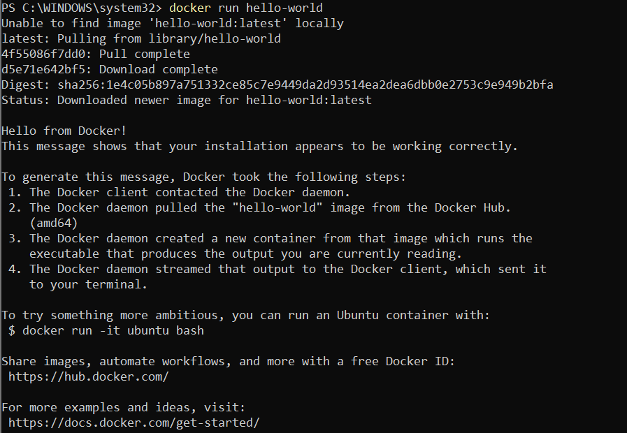

---

### ნაბიჯი 2: ინტერაქტიული Ubuntu კონტეინერის გაშვება

**ბრძანება:**

```bash
docker run -it ubuntu bash
```

**აღწერა:** უშვებს Ubuntu-ს კონტეინერს ინტერაქტიული ტერმინალით (`-it`), რომელშიც `bash` მუშაობს. პრომპტი იცვლება `root@<container_id>:/#`-ად, რაც აჩვენებს, რომ კონტეინერის შიგნით ვარ.

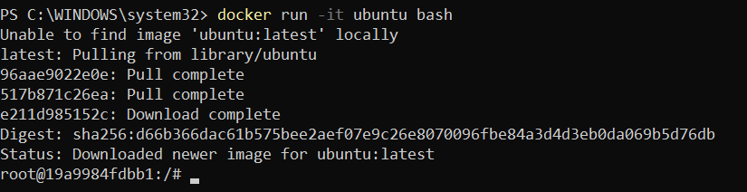

---

### ნაბიჯი 3: curl-ის დაყენება და ინტერნეტთან წვდომის შემოწმება

**ბრძანებები (კონტეინერის შიგნით):**

```bash
apt update
apt install -y curl
curl -I https://example.com
```

**აღწერა:** `apt update` განაახლებს პაკეტების სიებს, `apt install -y curl` კი დააინსტალირებს curl-ს. `curl -I` ითხოვს მხოლოდ `https://example.com`-ის HTTP ჰედერებს. პასუხი `HTTP/2 200` ადასტურებს, რომ კონტეინერს აქვს ინტერნეტთან წვდომა.

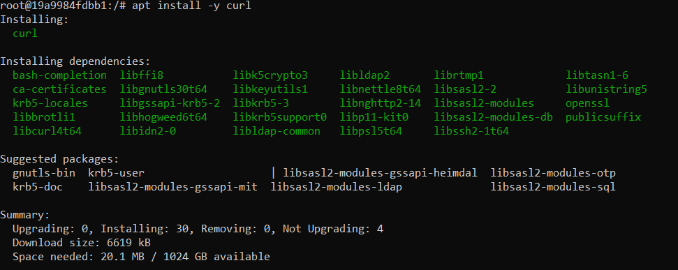
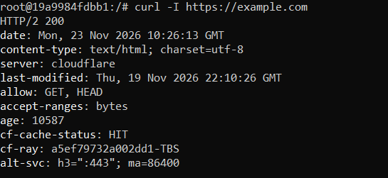

---

### ნაბიჯი 4: კონტეინერიდან გამოსვლა

**ბრძანება:**

```bash
exit
```

**აღწერა:** გამოდის კონტეინერის shell-იდან და ბრუნდება კომპიუტერის PowerShell-ის პრომპტზე.

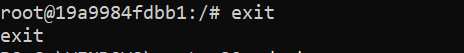

---

### ნაბიჯი 5: კონტეინერის ჩვენება, გაჩერება და წაშლა (არასავალდებულო)

**ბრძანებები:**

```bash
docker ps -a
docker stop <container_id>
docker rm <container_id>
docker ps -a
```

**აღწერა:** `docker ps -a` აჩვენებს ყველა კონტეინერს, გაჩერებულის ჩათვლით. `docker stop` აჩერებს გაშვებულ კონტეინერს (შესაძლოა უკვე გაჩერებული იყოს), `docker rm` კი შლის მას. განმეორებით `docker ps -a` ადასტურებს, რომ კონტეინერი აღარ არსებობს.

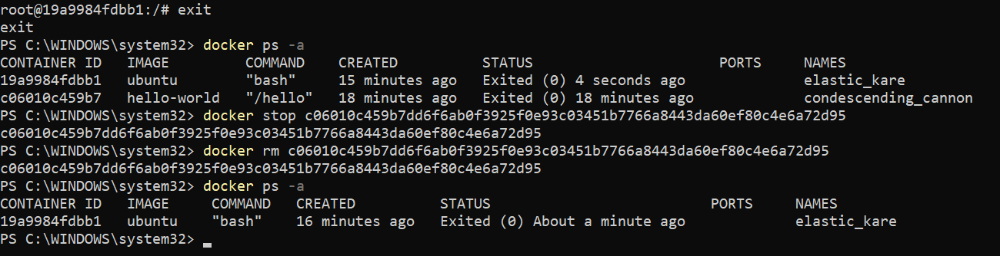

---

## ნაწილი 2: Python-ის აპლიკაციის იმიჯის აგება

### ნაბიჯი 1: სამუშაო საქაღალდის შექმნა

**ბრძანებები:**

```powershell
cd ~\Desktop
mkdir docker-assignment
cd docker-assignment
```

**აღწერა:** ქმნის პროექტის საქაღალდეს Desktop-ზე და გადადის მასში.

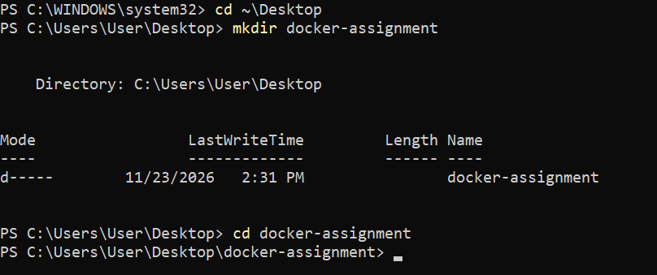

---

### ნაბიჯი 2: მარტივი Python სკრიპტის შექმნა

**`app.py`-ის შიგთავსი:**

```python
print("Hello from my custom Docker container!")
print("Docker assignment: Python app is running successfully.")
```

**აღწერა:** ვქმნით `app.py` ფაილს პროექტის საქაღალდეში VS Code-ის დახმარებით. სკრიპტი ბეჭდავს ორ შეტყობინებას, ის დაკოპირდება Docker-ის იმიჯში და გაეშვება კონტეინერის გაშვებისას.

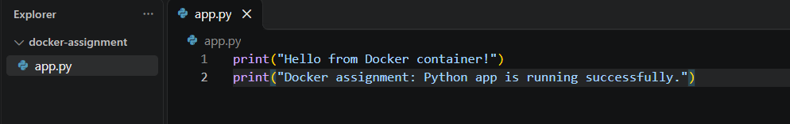

---

### ნაბიჯი 3: Dockerfile-ის შექმნა

**`Dockerfile`-ის შიგთავსი:**

```dockerfile
FROM python:3.12-slim
WORKDIR /app
COPY app.py .
CMD ["python", "app.py"]
```

- `FROM python:3.12-slim` იყენებს პატარა ოფიციალურ Python-ის იმიჯს ბაზად.
- `WORKDIR /app` ადგენს `/app`-ს იმიჯის შიგნით სამუშაო დირექტორიად.
- `COPY app.py .` აკოპირებს სკრიპტს სამუშაო დირექტორიაში.
- `CMD ["python", "app.py"]` უშვებს სკრიპტს კონტეინერის გაშვებისას.

**აღწერა:** ქმნის ფაილს სახელად `Dockerfile` პროექტის საქაღალდეში VS Code-ის დახმარებით.

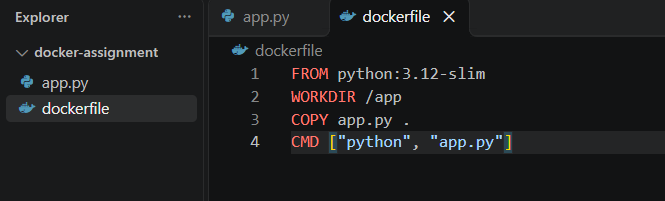

---

### ნაბიჯი 4: Docker იმიჯის აგება

**ბრძანება:**

```bash
docker build -t my-python-app .
```

**აღწერა:** აგებს იმიჯს მიმდინარე საქაღალდეში (`.`) არსებული `Dockerfile`-დან და `-t` ფლაგით არქმევს მას `my-python-app`.

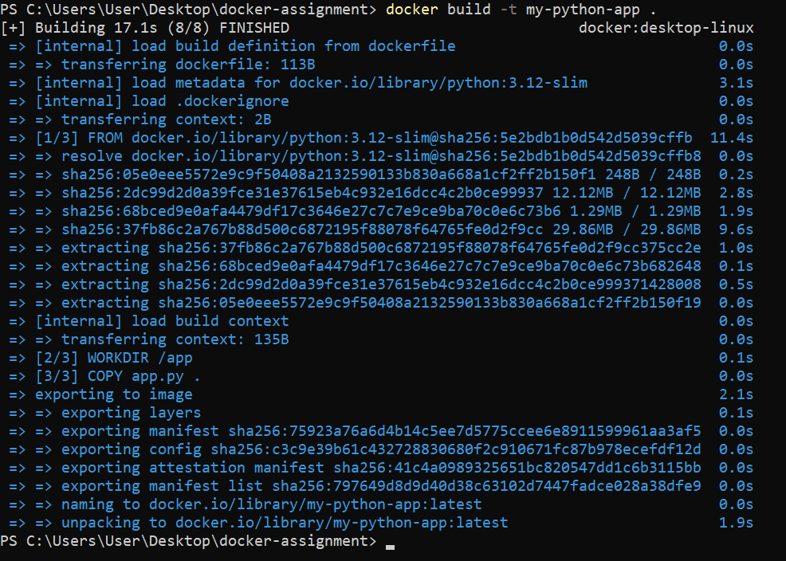

---

### ნაბიჯი 5: კონტეინერის გაშვება შექმნილი იმიჯიდან

**ბრძანება:**

```bash
docker run my-python-app
```

**აღწერა:** ქმნის და უშვებს კონტეინერს იმიჯიდან. კონტეინერი ასრულებს `app.py`-ს, ბეჭდავს ორ შეტყობინებას და შემდეგ ჩერდება.

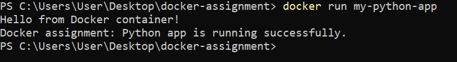

---

### ნაბიჯი 6: Tag-ის მინიჭება და ყველა იმიჯის ჩვენება

**ბრძანებები:**

```bash
docker tag my-python-app my-python-app:v1
docker images
```

**აღწერა:** `docker tag` არსებულ იმიჯს ამატებს ახალ თეგს (`v1`) მისი კოპირების გარეშე. `docker images` აჩვენებს ყველა ლოკალურ იმიჯს, სადაც `my-python-app` ჩანს როგორც `latest`, ისე `v1` თეგით, ორივე ერთსა და იმავე იმიჯის ID-ზე მიუთითებს.

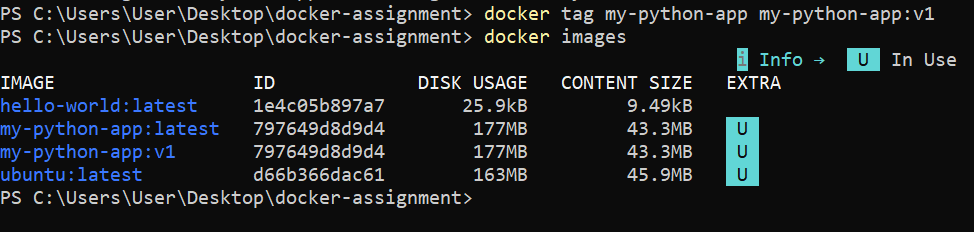

---

## ნაწილი 3: Docker Volume-ის გამოყენება მონაცემების შესანახად

### ნაბიჯი 1: Docker Volume-ის შექმნა

**ბრძანებები:**

```bash
docker volume create my-volume
docker volume ls
```

**აღწერა:** ქმნის Volume-ს `my-volume`. `docker volume ls` აჩვენებს Volume-ების სიას და ადასტურებს, რომ ის არსებობს.

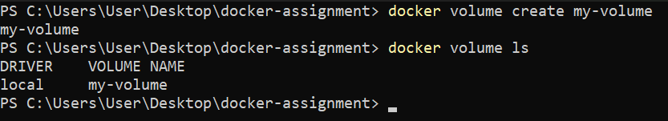

---

### ნაბიჯი 2: კონტეინერის გაშვება მიბმული Volume-ით

**ბრძანება:**

```bash
docker run -it --name container1 -v my-volume:/data ubuntu bash
```

**აღწერა:** უშვებს ინტერაქტიულ Ubuntu-ს კონტეინერს სახელად `container1` და `-v my-volume:/data`-ით მასში `/data` მისამართზე ამაგრებს (mount) `my-volume`-ს.

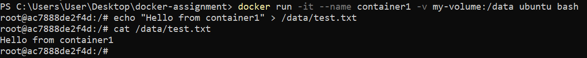

---

### ნაბიჯი 3: ფაილის შექმნა და შენახვა კონტეინერის შიგნით

**ბრძანებები (`container1`-ის შიგნით):**

```bash
echo "Hello from container 1" > /data/test.txt
cat /data/test.txt
exit
```

**აღწერა:** `/data/test.txt`-ში წერს ტექსტის ერთ ხაზს, `cat`-ით აჩვენებს, რომ ის შენახულია, და შემდეგ გამოდის კონტეინერიდან.


---

### ნაბიჯი 4: მეორე კონტეინერის გაშვება იმავე Volume-ით და ფაილის შენახვის დადასტურება

**ბრძანებები:**

```bash
docker run -it --name container2 -v my-volume:/data ubuntu bash
cat /data/test.txt
exit
```

**აღწერა:** უშვებს მეორე კონტეინერს (`container2`) და მასში იმავე Volume-ს ამაგრებს. `cat /data/test.txt` ბეჭდავს `Hello from container 1`-ს, რაც ადასტურებს, რომ მონაცემები Volume-ში შენარჩუნდა, მიუხედავად იმისა, რომ პირველი კონტეინერი უკვე გაჩერებული იყო.

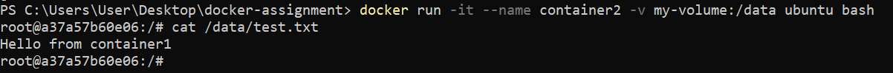

**დამატებითი შემოწმება:**

```bash
docker volume inspect my-volume
docker ps -a
```

`docker volume inspect` აჩვენებს Volume-ის დეტალებს, `docker ps -a` კი აჩვენებს, რომ `container1` და `container2` ორივე დასრულებულია, ხოლო მონაცემები Volume-ში რჩება.

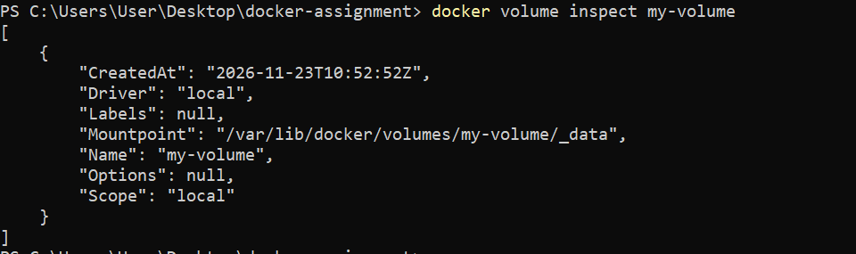
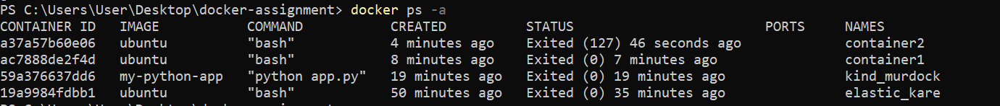
